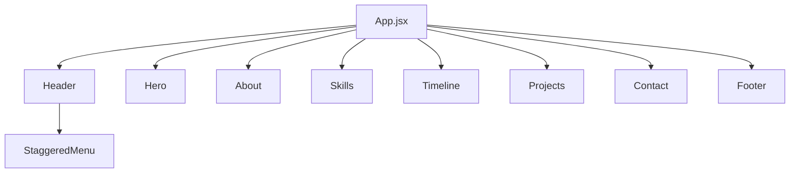

<div align="center">

# João Galimberti

**Portfolio**

A modern, responsive portfolio showcasing my projects, skills, and professional journey.

<br />

[](https://react.dev)
[](https://vitejs.dev)
[](https://developer.mozilla.org/docs/Web/JavaScript)
[](https://developer.mozilla.org/docs/Web/CSS)
[](https://eslint.org)

<br />

[About](#-about) · [Features](#-features) · [Quick start](#-quick-start) · [Architecture](#-architecture) · [Customization](#-customization) · [Deployment](#-deployment)

</div>

<br />

## ◆ About

A personal portfolio built with **React and Vite** to present my work in a way that reflects both my technical abilities and my design sensibility.

| | |
|---|---|
| **Design** | Clean, professional, and consistent |
| **Motion** | Smooth animations and interactions |
| **Layout** | Mobile-first and fully responsive |
| **Speed** | Fast loading and optimized rendering |
| **Structure** | Accessible and SEO-friendly |

<br />

## ◆ Features

| | Feature | Description |
|:-:|---|---|
| 🌊 | **Scroll reveals** | Sections fade in as they enter the viewport |
| 🎪 | **Staggered animations** | Content appears progressively, item by item |
| 📊 | **CountUp stats** | Animated numbers triggered on scroll |
| 🔗 | **Quick navigation** | Header menu with active section states |
| 📱 | **Mobile menu** | Staggered hamburger navigation, touch-friendly |
| 📬 | **Contact form** | Validated form, social links, and email |
| 🎯 | **Clear CTAs** | Call-to-action buttons across the page |

**Sections**

| Section | Purpose | Highlights |
|---|---|---|
| **Hero** | First impression | Animated entrance, photo, tagline, CTA buttons, scroll indicator |
| **About** | Background and story | Bio, values, downloadable resume |
| **Skills** | Technical competencies | Categories, proficiency indicators, technology icons |
| **Timeline** | Career and education | Chronological milestones with animated transitions |
| **Projects** | Work showcase | Cards with images, tech stack tags, live demo and GitHub links |
| **Contact** | Get in touch | Form with validation, social links, email |

<br />

## ◆ Quick start

```bash
git clone https://github.com/joaogalimberti/portfolio.git
cd portfolio
npm install
npm run dev
```

Open **http://localhost:5173**.

| Command | Description |
|---|---|
| `npm run dev` | Starts the dev server with HMR |
| `npm run build` | Builds the optimized production bundle |
| `npm run preview` | Previews the production build locally |
| `npm run lint` | Runs ESLint |

<br />

## ◆ Tech stack

| Layer | Tools |
|---|---|
| **UI** | React 18.3 with functional components and hooks |
| **Build** | Vite 5.4 with fast HMR |
| **Styling** | Modern CSS with animations and responsive breakpoints |
| **Quality** | ESLint |

**Key techniques**

- **React hooks:** `useState`, `useEffect`, `useRef`
- **Custom hook:** `useScrollReveal` for reusable scroll animations
- **Intersection Observer:** scroll-triggered reveals and counters
- **Responsive design:** mobile, tablet, and desktop breakpoints

<br />

## ◆ Architecture



```
portfolio/
├── src/
│   ├── App.jsx                   Main component
│   ├── main.jsx                  Entry point
│   ├── components/
│   │   ├── Hero.jsx
│   │   ├── About.jsx
│   │   ├── Skills.jsx
│   │   ├── Timeline.jsx
│   │   ├── Projects.jsx
│   │   ├── Contact.jsx
│   │   ├── Footer.jsx
│   │   ├── CountUp.jsx           Animated counter
│   │   └── Header/
│   │       ├── Header.jsx        Navigation
│   │       ├── StaggeredMenu.jsx Mobile menu
│   │       └── StaggeredMenu.css
│   ├── hooks/
│   │   └── useScrollReveal.js    Scroll animation hook
│   └── styles/
│       └── global.css            Global styles and variables
├── index.html
├── vite.config.js
├── eslint.config.js
└── package.json
```

<br />

## ◆ Special components

| Component | What it does |
|---|---|
| **CountUp** | Animates numbers from 0 to a target value, with configurable duration and decimal support. Starts when it enters the viewport |
| **useScrollReveal** | Custom hook built on the Intersection Observer API, with configurable thresholds. Reusable across components |
| **StaggeredMenu** | Mobile navigation with a hamburger animation and staggered item reveals |

<br />

## ◆ Design system

**Animation patterns**

| Pattern | Behavior |
|---|---|
| **Scroll reveal** | Fades in from the bottom: opacity `0 → 1`, `translateY(20px) → 0`, `0.6s ease` |
| **Stagger** | Each item appears `100ms` after the previous one, creating a wave effect |
| **CountUp** | Counts from `0` to the target over `2s` with ease-out |
| **Hover** | `scale(1.05)` with an elevated shadow and a `0.3s ease` transition |

**Responsive breakpoints**

| Device | Breakpoint | Layout |
|---|---|---|
| **Mobile** | below 640px | Single column, stacked |
| **Tablet** | 640px to 1024px | Two columns, adjusted spacing |
| **Desktop** | above 1024px | Full multi-column layout |

<br />

## ◆ Performance

| Metric | Target |
|---|---|
| First Contentful Paint | under 1.5s |
| Time to Interactive | under 3.5s |
| Lighthouse score | 90+ |
| Bundle size | under 150KB |

Optimized through code splitting, optimized assets, Intersection Observer for lazy reveals, GPU-accelerated CSS animations, a minimal JavaScript bundle, and Vite's optimized build.

<br />

## ◆ Customization

| What | Where |
|---|---|
| Personal info | `Hero.jsx` |
| About section | `About.jsx` |
| Skills | skills array in `Skills.jsx` |
| Projects | `Projects.jsx` |
| Timeline events | `Timeline.jsx` |
| Colors | CSS variables in `global.css` |
| Fonts | font imports in `index.html` |
| Animations | timing in component styles |

<br />

## ◆ Deployment

Run `npm run build` and deploy the generated `dist` folder.

| Platform | Command | Auto deploy |
|---|---|:-:|
| **Vercel** | `vercel` | ✅ Git integration |
| **Netlify** | `netlify deploy` | ✅ Git integration |
| **GitHub Pages** | `npm run build` + push to `gh-pages` | ✅ GitHub Actions |

<br />

<div align="center">

[](mailto:joaogalimberti@gmail.com)
[](https://www.linkedin.com/in/joaogalimberti/)
[](https://github.com/joaogalimberti)

<br />

*My professional story, told through modern web development.*

</div>
